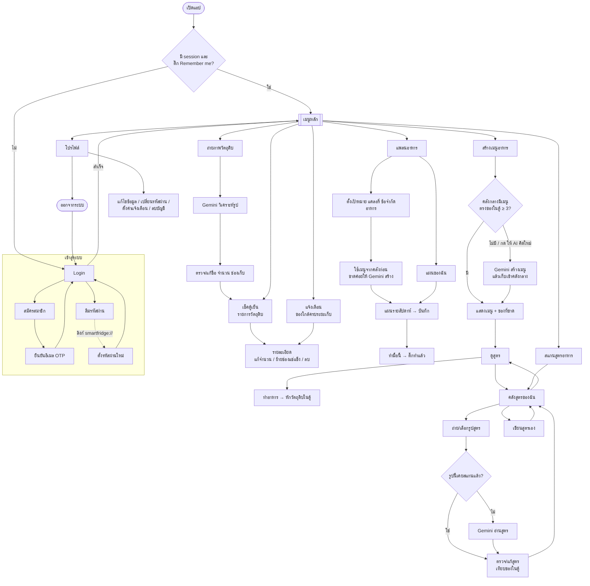

# SmartFridge.AI — User Flowchart (ฉบับย่อ)

อัปเดตล่าสุด: 6 พ.ย. 2026 · อ้างอิงการนำทางจริงใน `lib/screens/`

## สรุป 6 ฟีเจอร์จากเมนูหลัก

| ฟีเจอร์ | หน้าแรก | ผลลัพธ์ |
|---|---|---|
| ถ่ายภาพวัตถุดิบ | `ImageScanning` → `ResultScreen` | เพิ่มของเข้า `fridge_items` |
| เช็คตู้เย็น | `InventoryScreen` → `ItemDetailScreen` | ดู/แก้/ย้ายช่องเก็บ |
| แจ้งเตือน | `ExpirationAlertScreen` | เห็นของใกล้ครบระยะเก็บ |
| สร้างเมนูอาหาร | `AiRecipeScreen` | เมนูจากคลังกลางหรือ Gemini |
| สแกนสูตรอาหาร | `SavedRecipesScreen` → `ScanRecipeCaptureScreen` | บันทึกสูตรลง `user_saved_recipes` |
| แพลนอาหาร | `PlanMenuScreen` → `MealPlanScreen` / `MyPlanScreen` | แผนใน `meal_plans` + `weekly_meals` |

ทุกจุดที่เรียก AI จะ **ค้นคลังกลาง (`recipes`) ก่อน** แล้วค่อยเรียก Gemini เพื่อประหยัด token
